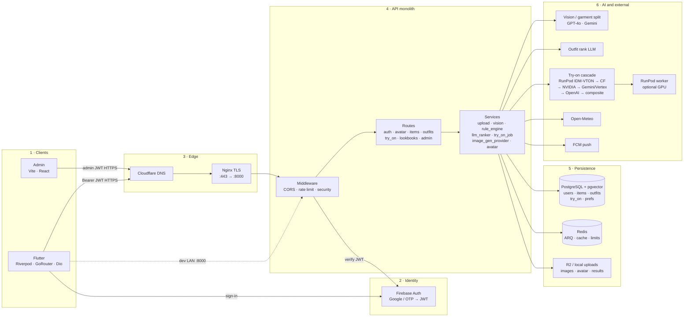

# DrapeAI — draw.io Mermaid architecture

> **draw.io:** Arrange → Insert → Advanced → Mermaid → paste the block below.
> **Last updated:** 2026-08-08

## End-to-end (left → right)

**Flow:** Clients → Firebase JWT → DNS/Nginx → FastAPI (middleware → routes → services) → Postgres/Redis/R2 and AI providers (vision, outfit rank, try-on cascade, weather, push).
